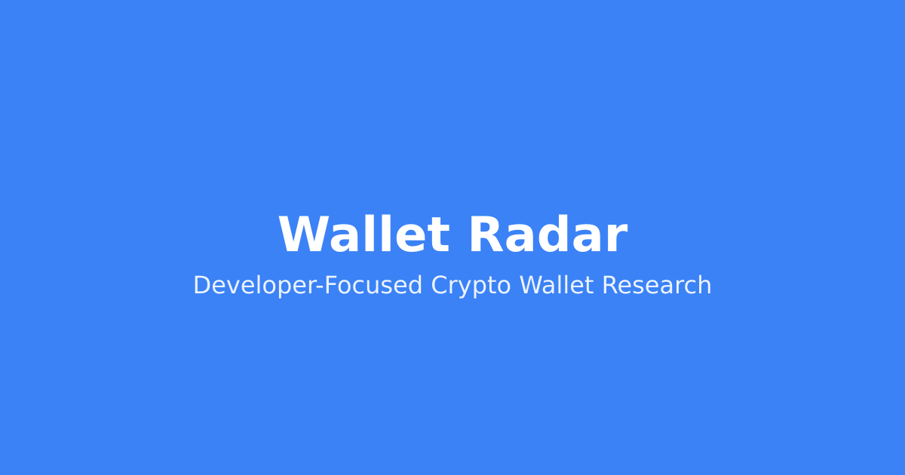
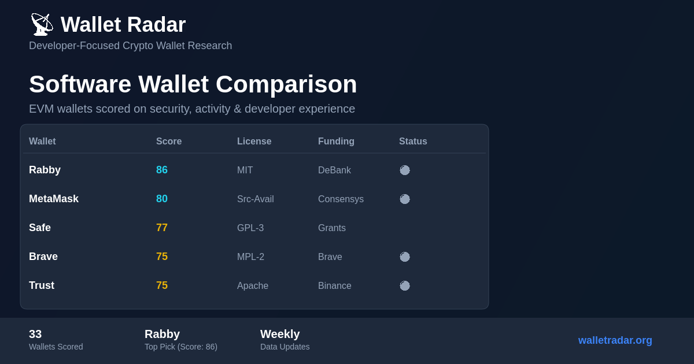
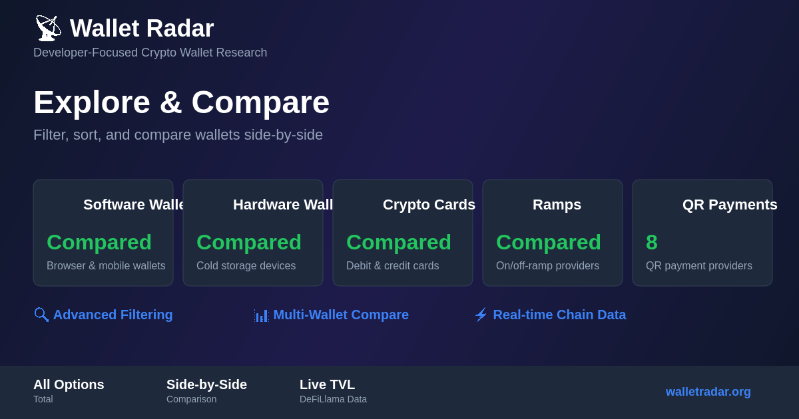

<div align="center">



# Wallet Radar

**Independent research on wallets, cards and ramps, for developers**

[](https://github.com/chimera-defi/walletradar/actions/workflows/commit-message-check.yml)
[](https://github.com/chimera-defi/walletradar/actions/workflows/pr-attribution-check.yml)
[](https://github.com/chimera-defi/walletradar)
[](https://walletradar.org)

[Visit the website](https://walletradar.org) | [Compare products](https://walletradar.org/explore) | [Documentation](https://walletradar.org/docs)

</div>

---

## What is Wallet Radar?

Wallet Radar compares crypto access products so a developer can pick one fast. It tracks **147 products** (software wallets, hardware wallets, crypto cards, on/off-ramps) and scores each from columns you can see in the tables.

The goal: find a MetaMask alternative with a mobile app and a browser extension, stable enough for daily development. Fewer releases per month means fewer surprise breaking changes.

What you get:
- **Scores you can reproduce.** The method is in [CONTRIBUTING.md](./CONTRIBUTING.md) and the tables are scored by `scripts/sync_table_scores.js`.
- **GitHub activity.** Last commit, release rate and maintenance status, from the GitHub API.
- **Audit history,** with links to the reports.
- **Developer experience.** Docs, SDKs, simulation, error quality.
- **Chain support** per wallet.

## What we compare

| Category | Count | What it covers |
|----------|-------|----------------|
| Software wallets | 33 | Browser extensions, mobile apps, desktop wallets |
| Hardware wallets | 43 | Cold storage devices and secure element details |
| Crypto cards | 57 | Crypto-backed credit and debit cards |
| On/off-ramps | 22 | Fiat-to-crypto providers |

Counts are table rows, including discontinued and partial-data rows. QR payment providers are in [QR_PAYMENTS.md](./data/tables/QR_PAYMENTS.md).

Note: the dataset files moved to `data/tables/` and ABOUT, DATA_SOURCES and GLOSSARY to `docs/site/` (MERCHANT_FEED to `docs/`), so GitHub deep links to their old root paths no longer resolve.

## Bot-protected sites

Some provider sites block automated checks (403, 429, timeout). A headless Chromium pass (`scripts/verify-crypto-cards.js`) clears some of them. The rest need a person in a browser. Anything unconfirmed is marked UNVERIFIED in the data, with the reason in the [verification log](https://github.com/chimera-defi/walletradar/blob/main/docs/VERIFICATION.md).

## Screenshots

<div align="center">





</div>

## Features

- **Filter and compare.** Filter by platform, features (transaction simulation, scam alerts, testnets) and licence (open source, source-available, proprietary). Compare up to 4 wallets side by side.
- **Scoring.** Security (audits, open source, simulation), GitHub activity, developer experience, platform coverage.
- **Data updates.** A weekly GitHub Action refreshes GitHub activity data and opens a PR. Prices, licences, audits and custody are checked by hand against primary sources and shipped through reviewed PRs. A second weekly Action regenerates the hardware wallet Merchant Center feed ([MERCHANT_FEED.md](https://github.com/chimera-defi/walletradar/blob/main/docs/MERCHANT_FEED.md)).
- **Live chain data.** TVL from DeFiLlama.
- **UI.** Next.js static site, dark mode, responsive, structured data for SEO.

## Tech stack

- **Frontend:** Next.js 16, React 19, Tailwind CSS 4, TypeScript 6, Lucide icons, react-markdown with GFM.
- **Data:** Markdown tables parsed at build time. Sources: GitHub REST API, WalletBeat, Rabby API, Trust Wallet registry, DeFiLlama.
- **Hosting and CI:** AWS Amplify, GitHub Actions. OG images are generated with Canvas and Sharp.

## Get started

Needs Node.js 22 and Bun 1.3+.

```bash
git clone https://github.com/chimera-defi/walletradar.git
cd walletradar/frontend
bun install
bun run dev        # http://localhost:3000
```

Build and preview the static export:

```bash
bun run build
bun run start
```

| Script | What it does |
|--------|--------------|
| `bun run dev` | Dev server |
| `bun run build` | Production build (static export to `out/`) |
| `bun run start` | Serve `out/` locally |
| `bun run lint` | ESLint |
| `bun run type-check` | TypeScript check |
| `bun run test` | Data smoke test |
| `bun run generate-og` | Generate OG images |

From the repo root, run `bunx vitest run tests/` for the unit tests.

## Project structure

```
frontend/          Next.js app (src/, public/, scripts/)
scripts/           Data tooling (see scripts/README.md)
tests/             Vitest unit tests
data/              Sidecar attributes, merchant pricing
articles/          SEO articles
docs/              Maintainer docs (verification log, SEO notes, incident record)
*.md (root)        Data tables, *_DETAILS.md, and site pages
```

## Data sources

| Source | Used for | Link |
|--------|----------|------|
| GitHub API | Stars, issues, release rate, activity | [docs](https://docs.github.com/en/rest) |
| WalletBeat | Licence, device support, audits | [walletbeat.fyi](https://walletbeat.fyi) |
| Rabby API | Chain counts | [api.rabby.io](https://api.rabby.io/v1/chain/list) |
| Trust Wallet registry | Network support | [GitHub](https://github.com/trustwallet/wallet-core) |
| DeFiLlama | Chain TVL | [defillama.com](https://defillama.com) |

Details and attribution: [DATA_SOURCES.md](./docs/site/DATA_SOURCES.md).

## Refresh data

```bash
cd scripts
./refresh-github-data.sh --markdown   # also --json; set GITHUB_TOKEN for full runs
```

Commit refreshed data through a PR after review. Full script docs: [scripts/README.md](https://github.com/chimera-defi/walletradar/blob/main/scripts/README.md).

## Documentation

- [SOFTWARE_WALLETS.md](./data/tables/SOFTWARE_WALLETS.md): software wallets (33 rows)
- [HARDWARE_WALLETS.md](./data/tables/HARDWARE_WALLETS.md): hardware wallets (43 rows)
- [CRYPTO_CARDS.md](./data/tables/CRYPTO_CARDS.md): crypto cards (57 rows)
- [RAMPS.md](./data/tables/RAMPS.md): on/off-ramps (22 rows)
- [QR_PAYMENTS.md](./data/tables/QR_PAYMENTS.md): QR payment providers
- [ABOUT.md](./docs/site/ABOUT.md), [GLOSSARY.md](./docs/site/GLOSSARY.md), [DATA_SOURCES.md](./docs/site/DATA_SOURCES.md)
- [CONTRIBUTING.md](./CONTRIBUTING.md): how to contribute and how scores work
- [CHANGELOG.md](./CHANGELOG.md): change history
- [Verification log](https://github.com/chimera-defi/walletradar/blob/main/docs/VERIFICATION.md): what was verified, what is not, and why

## Trust and transparency

- No logins, no wallet connections, no key requests.
- No personal data collection or tracking beyond standard analytics.
- Every data source is linked.
- The code is open on GitHub.
- The scoring method is published and reproducible.
- Commercial links, if any, are disclosed and never affect rankings.

Wallet Radar is educational research. It is not financial advice and does not tell you what to buy. Verify on official sites before you move funds.

## Contributing

1. **Report wrong data:** [open an issue](https://github.com/chimera-defi/walletradar/issues).
2. **Add a product:** see [CONTRIBUTING.md](./CONTRIBUTING.md).
3. **Fix docs or code:** open a PR.

## License

MIT.

## Links

- Website: [walletradar.org](https://walletradar.org)
- GitHub: [github.com/chimera-defi/walletradar](https://github.com/chimera-defi/walletradar)
- Issues: [github.com/chimera-defi/walletradar/issues](https://github.com/chimera-defi/walletradar/issues)
